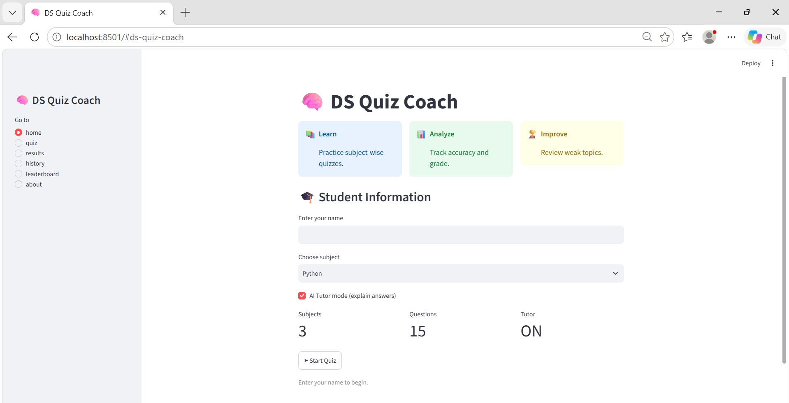
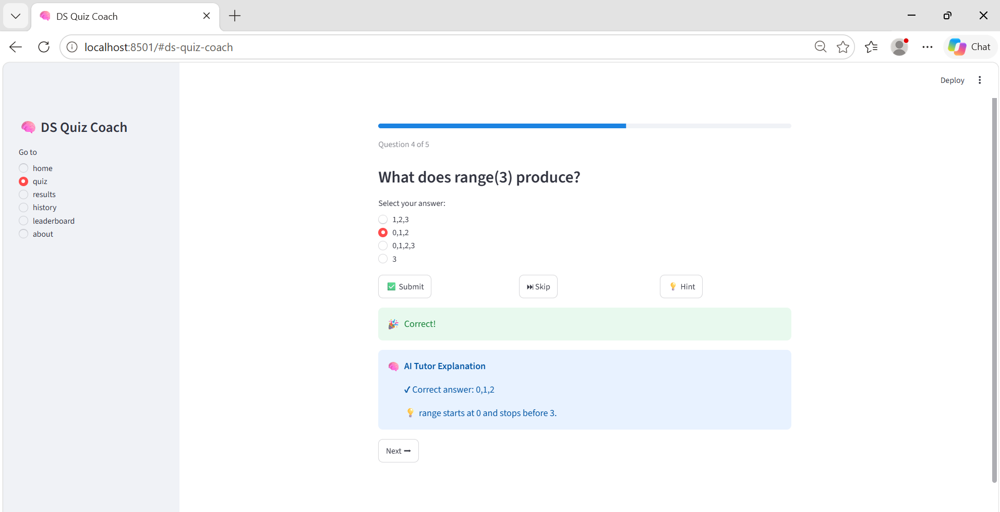
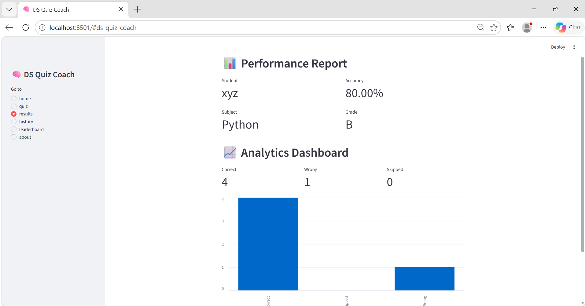
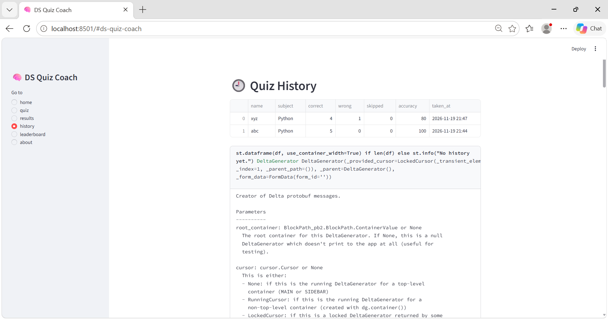
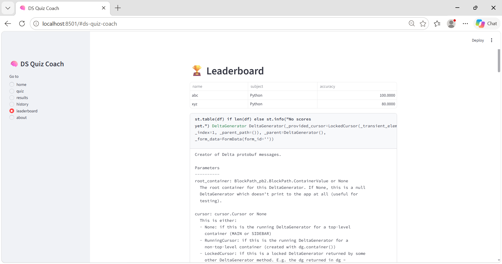
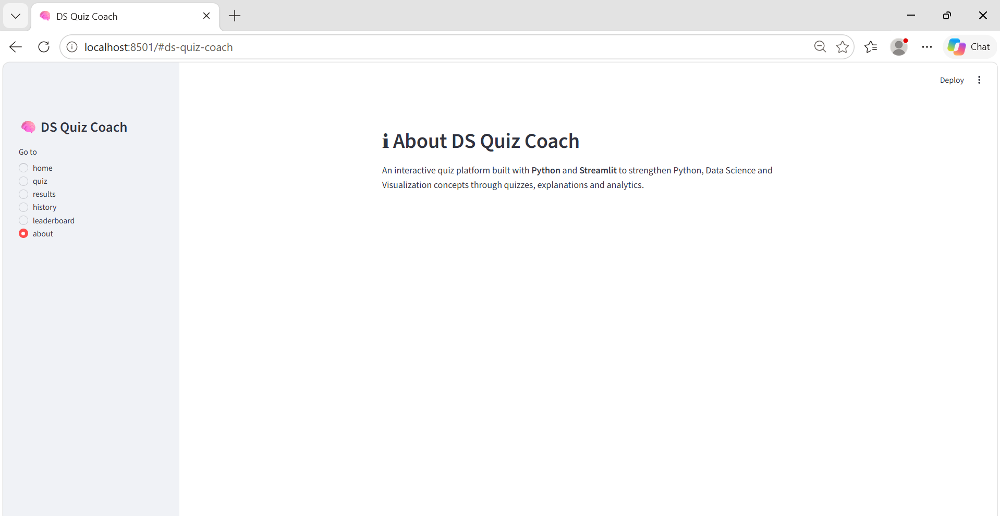

# DS Quiz Coach


An interactive quiz application built with Python and Streamlit.

---

## Project Overview

DS Quiz Coach helps students practise Python, Data Science and Data Visualization concepts using multiple-choice quizzes. It offers instant feedback, tutor-style explanations, quiz history, a leaderboard and performance analytics.

---

## Features

- Interactive MCQ Quiz
- AI Tutor Mode
- Performance Analytics
- Leaderboard
- Quiz History
- Hint System
- Skip Questions
- SQLite Database
- Timestamped Quiz Attempts

---

## Tech Stack

| Technology | Purpose |
|------------|---------|
| Python | Core Programming |
| Streamlit | Web Application |
| SQLite | Database |
| Pandas | Data Handling and Charts |
| Git & GitHub | Version Control |

---

## Project Structure

```text
DS-Quiz-Coach/
│
├── app.py
├── quiz.db
├── requirements.txt
│
├── screenshots/
│   ├── home.png
│   ├── quiz.png
│   ├── result.png
│   ├── history.png
│   ├── leaderboard.png
│   └── about.png
│
└── README.md
```

---

## Installation

Clone the repository

```bash
git clone https://github.com/rinichowbe/DS-Quiz-Coach.git
```

Move into the project directory

```bash
cd DS-Quiz-Coach
```

Install dependencies

```bash
pip install -r requirements.txt
```

Run the application

```bash
streamlit run app.py
```

---

## Screenshots

## Home


## Quiz


## Results


## History


## Leaderboard


## About


---

## Future Enhancements

- AI-generated quiz questions
- Adaptive difficulty levels
- User authentication
- Cloud database integration
- Personalized learning recommendations
- AI chatbot for doubt solving

---

**Rini Chowbe**

B.Tech (Artificial Intelligence & Machine Learning)
- GitHub: https://github.com/rinichowbe

---

## If you like this project

Give it a star on GitHub!
